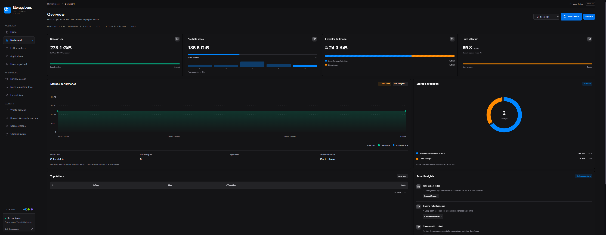
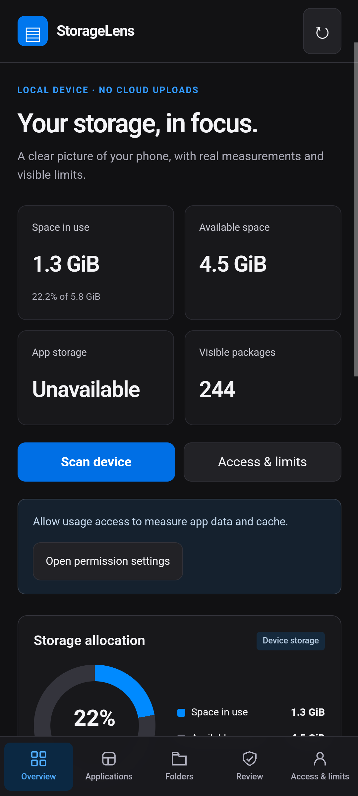

# StorageLens

A local storage inspector for Windows and Android, preserving the charcoal dashboard and Watermelon-inspired Home design. **No Vercel deployment or cloud account is needed.** A website hosted on Vercel cannot directly inspect an entire PC: the Windows helper or installed native app performs that work locally.

This is a functional **1.1.0 preview**, with permission and measurement limits. It is not an antivirus, and app associations are not exact uninstall savings.

## Download and install

| Platform | Download |
| --- | --- |
| **Windows x64** | **[Download Windows installer](https://github.com/gopichandchikoti/StorageLens/releases/download/latest-build/StorageLens-Setup.exe)** |
| **Android 11+** | **[Download Android APK](https://github.com/gopichandchikoti/StorageLens/releases/download/latest-build/StorageLens-Android.apk)** |

[SHA-256 checksums](https://github.com/gopichandchikoti/StorageLens/releases/download/latest-build/SHA256SUMS.txt) ? [Build notes](https://github.com/gopichandchikoti/StorageLens/releases/download/latest-build/BUILD-NOTES.md) ? [All releases](https://github.com/gopichandchikoti/StorageLens/releases)

These fixed links point to the latest **verified rolling preview**, built from `main`. Both platform jobs must pass before downloads refresh. The [build workflow](https://github.com/gopichandchikoti/StorageLens/actions/workflows/preview.yml) records the commit, checks, package hashes and Android signer.

**Windows:** run `StorageLens-Setup.exe`, then open StorageLens from Start. The installer is per-user, includes Python/.NET, and needs Microsoft Edge WebView2 Runtime. It is **unsigned**. Close StorageLens before updating; your scan data is retained. Uninstall through Windows Settings > Apps.

**Android:** transfer `StorageLens-Android.apk` to your phone and install it. Open **Access & limits** to choose Usage access and shared-storage grants. Published previews use a dedicated persistent **preview certificate** and are debuggable; they are not Play Store/production releases. If you installed an earlier local Android Debug-signed APK, Android requires uninstalling it before this different signer can be installed; uninstalling removes its phone-local scan records. Subsequent GitHub previews retain the same signer and package ID.

To verify a Windows download: `Get-FileHash .\StorageLens-Setup.exe -Algorithm SHA256`, then compare the result with `SHA256SUMS.txt`. APK certificate fingerprints and both package digests are also in [manifest.json](https://github.com/gopichandchikoti/StorageLens/releases/download/latest-build/manifest.json).

## Choose a version

| Folder | Run / install | Data |
| --- | --- | --- |
| Web | Double-click the root Start-StorageLens.cmd; Python 3.13 required; opens http://127.0.0.1:8766/ | Existing repository .data/storage.sqlite3 and inventory retained |
| Windows | Install artifacts/downloads/StorageLens-Setup-1.1.0-preview-win-x64.exe | %LOCALAPPDATA%/StorageLens/data; no Python installation needed |
| Android | Install artifacts/downloads/StorageLens-1.1.0-preview-android.apk on Android 11+ | App-private SQLite snapshots on that phone |

Windows opens maximized on first launch, supports resize/minimize/maximize, zoom, and remembered bounds. Microsoft Edge WebView2 Runtime must be installed; a missing-runtime screen links to Microsoft's official download. The installer is per-user and needs no administrator rights. It is unsigned. Android GitHub previews use a dedicated persistent preview signer; local builds without that configuration use Android Debug. Play Store publication and production signing are not configured.

The root Web launcher remains compatible. Windows starts its own authenticated loopback helper on a random port; it can run alongside Web. To use the existing PC records in Windows, choose **File → Open existing StorageLens data folder** and select this repository's .data folder. Opening existing data does not copy it into the installer. Uninstalling Windows retains scan data.

## Screenshots

The Windows capture uses a labelled synthetic scan fixture; the Android capture is from the API 35 emulator. Figures are verification data, not a report about your device.



<details><summary>Android phone overview</summary>



</details>

## Features and limits

- Windows/Web: select drives or a folder; Quick logical-size scans, Deep allocated-size scans with hard-link deduplication, cancellation, folder drill-down, large files, saved snapshots, growth comparisons, coverage and CSV exports.
- Windows/Web relocation: **Move to another drive** suggests large personal downloads, media and documents from saved scans. Use **Review move** or select multiple files/folders in explorer views, browse another NTFS drive, and create a new destination folder. CopyFileEx preserves named streams; SHA-256 verification precedes recycling originals. Progress, cancellation, history and conflict/free-space checks are included. C: space remains occupied in Recycle Bin until you remove those originals through Windows.
- Windows/Web applications: registrations, reported sizes, measured install folders, separately labelled associated data and related totals. Shared folders overlap; unavailable values are not proof of zero use.
- Reviewed Windows cleanup explains consequences, validates fresh metadata, requires typed confirmation, and requests Windows Recycle Bin. Protected/system/install paths and StorageLens data are blocked. Recycled files still occupy disk until you remove them through Windows.
- Android: storage volumes, real OS-reported app/data/cache statistics with Usage access, system/disabled/no-launcher package filters, permissions and installer details, Quick/Deep accessible-storage scans, saved results per storage root, cancellation, system app settings/uninstall and supported media trash review.
- Android Quick scans cover common shared folders to two levels and are deliberately partial. Deep scans recurse accessible shared storage. A selected-folder picker can grant a narrower read scope. Other apps' private files, Android/data, work profiles and OS-protected locations are not unlocked by all-files access.
- Security review presents inventory signals and Windows Defender status / OS security settings. Missing launcher icons are often normal services. Neither version promises detection of every hidden executable, malware or rootkit.

App-size figures and folder totals can overlap. Android total = app files + data; cache is part of data. Windows reported sizes may be outdated. Disk used space includes filesystem metadata, restore points and protected content that a folder scan may not measure. Read coverage messages and dates before acting.

No automatic deletion, permanent-delete fallback, telemetry, startup task or silent privilege elevation was added. Android has no Internet permission. There is no iPhone build: iOS sandboxing prevents this kind of whole-device inspection by an ordinary third-party app.

## Build and verify

Use Windows x64, Python 3.13, an installed Inno Setup 6 compiler, and network access for verified build dependencies. Keep local tools under ignored work/. The SDK bootstrap uses global.json and verifies Microsoft's SHA-512.

~~~powershell
python tools/bootstrap_windows.py
python -m venv work/python-build
work/python-build/Scripts/python.exe -m pip install --require-hashes -r Windows/requirements-build.txt
python tools/build_windows.py
~~~

Set STORAGELENS_DOTNET or STORAGELENS_ISCC if the local tool locations differ. Android requires JDK 17 or 21, Android SDK platform 36 and build tools; set JAVA_HOME and ANDROID_HOME. The wrapper is checksum-verified before use.

~~~powershell
./tools/build_android.ps1
python -m unittest discover -s tests -p test_*.py -v
python tools/check_source.py
python tools/release_manifest.py
~~~

The Android script runs assembly, JVM tests and lint. Connected Android instrumentation is opt-in via -Test; use only an intended test device/emulator. New UI copy lives in public/storagelens.model.json; tools/prepare_platforms.py validates and generates bundled copies. Existing Web English templates are a documented localization gap.

See [architecture and actual verification evidence](docs/architecture.md), [Web details](Web/README.md), and [third-party notices](THIRD_PARTY_NOTICES.md). Native installers/APKs, checksums, test captures and local build outputs are ignored by Git. CI verifies source hygiene and the Windows scanner when run; native packaging/instrumentation still require the local documented checks. GitHub builds and rolling preview downloads are configured below. Store submission and production signing are not configured.

Source snapshots accumulate on Windows; no automatic snapshot retention policy was added. Scan databases and exported file paths are private. Do not upload .data, inventory.json, WebView profiles or local logs to a public portfolio repository.

## Relocation enhancements

The tracked [enhancement requirements and follow-ups](docs/enhancements.md) distinguish
the delivered Windows/Web workflow from planned platform extensions.

Windows/Web moves support up to 25 non-overlapping selections and 25,000 entries per review, with a 30-second metadata review limit. Existing destination names are never overwritten. Incomplete copies are retained for review, not silently deleted. Moving reads selected contents only after confirmation; scans remain metadata-only. Installed programs, app state, source projects, credentials, linked/cloud/special files, hard links and broad known-folder containers stay protected. Select personal child files/folders; moving them does not redirect Windows libraries. The default destination favors a fixed drive with more available space, but you choose the final path.

Android SD-card/provider moves, exFAT destinations, and Windows Known Folder Location migration are recorded enhancements, not implemented in this preview. Android 1.1.0 retains its existing scanner and OS cleanup controls. See architecture section 7 for acceptance and evidence.

## Releases and CI

| Event | Behavior |
| --- | --- |
| Push to `main`, including README-only changes | Build Windows and Android; run scanner tests, Windows packaged/install/UI/uninstall checks, Android JVM/lint/API 35 device tests; publish `latest-build` only when both jobs pass |
| Pull request | Build and check packages with read-only access; Android uses a disposable local debug key; no preview signing secrets or release publication |
| Manual workflow on `main` | Repeat the same build and preview verification |

The publisher downloads already checked artifacts on a separate runner, verifies their SHA-256/commit/version/signing metadata, rejects stale `main` revisions and Android version-code regressions, and refreshes the fixed asset names. Failed checks leave the last verified preview available. The rolling prerelease is separate from immutable versioned releases; no automatic stable release is created. Checksums detect byte changes, not trust in the publisher. Production Authenticode/store signing and hosted coverage metrics remain unconfigured.

## Repository layout

```text
Web/           Local dashboard, scanner, cleanup and relocation
Windows/       WPF/WebView2 host and installer definition
Android/       Offline Android app and device/JVM tests
public/        Shared authored UI content model
tests/        Scanner/API/relocation and packaged verification
tools/        Locked builds, native checks and release asset validation
docs/         Architecture, enhancements and supporting instructions
licenses/     Third-party license texts
.github/       Verified-build/preview workflow and dependency updates
```
