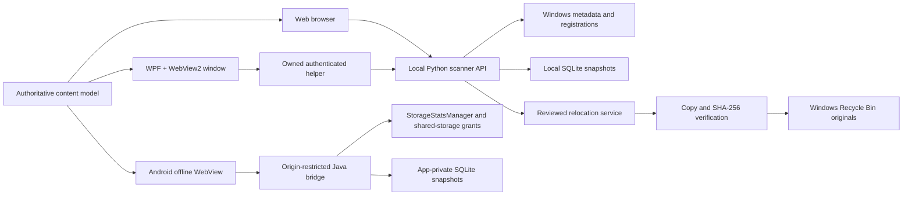

# StorageLens architecture and delivery evidence

## Contents

1. Scope and platform boundaries
2. Design and ownership
3. Data, native contracts and lifecycle
4. Privacy, security and recovery
5. Implementation plan and acceptance
6. Verification and residual limits
7. Relocation enhancement
8. GitHub previews and download delivery

## 1. Scope and platform boundaries

StorageLens is a local storage inspector for people who need to understand large
folders, installed applications and cleanup consequences. No cloud account,
Vercel deployment, subscription or remote device access is required.

| Platform | Support target | Inspection boundary | Delivery |
| --- | --- | --- | --- |
| Web | Windows 10/11, current Edge/Chrome, 320 CSS px and wider | Local Python helper; connected local drives and registered applications | Browser UI in `Web/` |
| Windows | Windows 10 22H2 / Windows 11, x64, mouse/keyboard, high DPI | Same scanner and reviewed recycling as Web | Large resizable WPF/WebView2 window, packaged backend, per-user EXE installer |
| Android | Android 11+ (API 30+), phones/tablets, rotation and touch | Visible packages, usage-access app statistics, user-granted shared storage | Native Android package, offline WebView UI and Java platform adapters |
| iPhone/iPad | Platform constraints documented, no native iOS build promised in this slice | iOS sandbox prevents a third-party app from enumerating every other app's private storage | N/A |

Android all-files access does not grant access to other apps' internal data or
`Android/data` and `Android/obb`. Usage access permits OS-reported package-size
statistics; denied and unsupported values must remain unknown, never zero.
No platform version claims to find every hidden app, rootkit or malware sample.

## 2. Design and ownership

Preserve the user's Capitalio dashboard and Watermelon Home references. Desktop
uses charcoal surfaces, blue actions, green/blue history and multicolor allocation.
Android adapts this language to readable touch cards and a bottom navigation bar.
Native window sizing follows the work area, with minimize/maximize/restore and
saved normal bounds. The first launch uses a large maximized window.

Two directions were considered: a complete native widget rewrite and a native
host retaining the established UI. Choose native hosts plus shared design assets
to preserve behavior and avoid duplicating the Windows scanner and cleanup policy.

Reference review (2026-11-17):

| Reference | Pattern and fit | Reuse |
| --- | --- | --- |
| [Microsoft Windows design](https://learn.microsoft.com/en-us/windows/apps/design/) | Resizable desktop navigation and keyboard behavior | Guidance; original UI code |
| [Android adaptive layouts](https://developer.android.com/design/ui/mobile/guides/layout-and-content/adapt-layout) | Reflow for phones/tablets rather than a stretched desktop | Guidance; original UI code |
| [Android WebView native bridge](https://developer.android.com/develop/ui/views/layout/webapps/native-api-access-jsbridge) | Local origin and narrowly allowed commands | AndroidX library with notices |
| Local StatsInfo source | WPF/self-contained packaging and per-user Inno Setup installer | Build convention, no identifiers or user data copied |
| Local SkyHop source | Android Gradle wrapper, SDK/JDK setup and APK verification | Wrapper infrastructure with Apache notice |

| Module | Responsibility | Public contract | Owned state | Dependencies |
| --- | --- | --- | --- | --- |
| Web scanner | Quick/deep metadata and compatible snapshots | Python scan API and loopback HTTP | SQLite snapshots and inventory | Windows metadata APIs |
| Web cleanup | Consequences, protected paths, expiring review tickets, recycle | Explicit preview/confirm operations | Local cleanup history | Scanner, Windows Shell |
| Windows host | Native window, backend process, isolated data/profile, lifecycle | Loopback readiness and authenticated commands | Window bounds and WebView profile | WPF/WebView2, bundled scanner |
| Android adapters | Storage volumes, packages, grants, scanning and OS cleanup controls | Versioned JSON native messages | Internal app snapshot; granted storage metadata | Android SDK/AndroidX |
| Content model | New authored native labels/errors/help | Semantic locale keys | `public/storagelens.model.json` | Bundled per-platform resources |

Existing Web templates and cleanup explanations contain legacy inline English.
Preserve these working flows and record localization as a legacy gap rather than
silently claim full localization. New native UI copy uses the content model.

## 3. Data, native contracts and lifecycle

Windows ships the Python backend; users do not install Python or run a terminal.
App state belongs under the user's local app-data directory, not the install
directory. The Web development launcher continues using the original repository
database. Builds never bundle the existing inventory or 1+ GiB personal database.

The desktop host starts its own helper on an OS-assigned loopback port, waits for
an explicit readiness receipt, restricts WebView navigation to that exact origin,
and cancels/waits for a scan before shutting down its owned helper. It never
terminates another StorageLens instance. Existing Web URLs remain compatible.

Android requests have bounded IDs, a method allowlist and bounded JSON input.
Only the main frame at `https://appassets.androidplatform.net` receives the bridge.
Expensive collection runs outside the UI thread. Package IDs and scan roots are
validated natively; JavaScript cannot execute shell commands. Pending operations
are bounded and cancellation is cooperative. Unavailable/grant-denied fields are
nullable with reasons. External-storage scans skip links and protected directories.

App totals on Android are `appBytes + dataBytes`; cache is a subset of data and is
displayed separately. Windows folder associations can overlap and remain estimates.
Neither platform adds shared associations to present invented reclaimable savings.

## 4. Privacy, security and recovery

Data stays local. Android has no network permission, remote updates, analytics or
backup/device-transfer of scan records. Windows local requests validate host,
origin and token; the native host blocks arbitrary remote navigation and permissions.
No silent elevation, scheduled startup, driver, permanent deletion or automatic
uninstall. Windows cleanup retains the existing typed review and Windows recycling.
Android app cleanup/uninstall uses OS confirmation and app storage settings; file
trash operations use the OS recoverable media flow when supported.

Security review shows inventory facts (system, disabled, no launcher, installer)
and available Windows Defender status. These are review signals, not malware verdicts.
Protected/private paths and OS visibility limits are visible in coverage.

Sources checked 2026-11-17:
- [Android StorageStatsManager](https://developer.android.com/reference/android/app/usage/StorageStatsManager)
- [Android all-files limits](https://developer.android.com/training/data-storage/manage-all-files)
- [Android package visibility](https://developer.android.com/training/package-visibility)
- [WebView2 distribution](https://learn.microsoft.com/en-us/microsoft-edge/webview2/concepts/distribution)
- [PyInstaller runtime paths](https://pyinstaller.org/en/stable/runtime-information.html)
- [Apple platform security](https://support.apple.com/guide/security/security-of-runtime-process-sec15bfe098e/web)

## 5. Implementation plan and acceptance

| Slice | Acceptance | Status |
| --- | --- | --- |
| Preserve Web | Separate folder, existing scans retained, launcher and real APIs pass | Passed locally |
| Windows | Native large window, packaged backend, installer EXE, isolated packaged smoke | Passed locally; unsigned preview |
| Android | Volume overview, real app statistics, granted-folder quick/deep scans, denied states, APK | Passed on API 35 emulator; physical device unverified |
| Enhancements | Clear app-size attribution, system/no-launcher review, OS security integration | Implemented and exercised |
| Delivery | Checksums, source/build commands, notices, accurate test evidence and limits | Local packages prepared; no public release |

The initial native build request did not authorize publication. The subsequent
README/download request explicitly authorized committing/pushing all app changes
and creating a public portfolio repository. Store submission and production signing
remain outside that authorization. Preview packages retain their actual signing labels.

## 6. Verification and residual limits

Execution date: 2026-11-17, Windows 11 x64 (build 26300), uncommitted local working
tree. The original staged Web files were preserved in the Git index; no reset,
commit or push was performed. Moving source into Web produces expected root-file
deletions and untracked platform folders until the user stages that reorganization.

| Check | Command / evidence | Actual result |
| --- | --- | --- |
| Scanner/transport regression | `python -m unittest discover -s tests -p test_*.py -v` | 10 passed; metadata, hard links, independent roots, state protection, stale reviews, foreign DB refusal, CSV injection and request/session denials |
| Packaged helper | `python tests/verify_packaged_backend.py` | Passed real Quick/Deep scans on owned synthetic files; hard-link deduplication, session denial and inventory; `artifacts/verification/packaged-backend.json` |
| Native installer lifecycle | `python tools/verify_windows_install.py` | Per-user install to an isolated folder, installed UI check, uninstall and retained scan DB all passed; `windows-installed/installer-verified.json` |
| Desktop UI | Internal `--data-dir … --verify …` with seeded and empty data | First launch maximized, Quick/Deep dialog, apps/security/Home navigation, 850×680 resize without horizontal overflow; WebView2 157.0.4341.60 |
| Web compatibility | Original workspace `work/check_api.py` against restarted port 8766 | Real folder/app/file/insight/growth/coverage/export APIs passed; original scan 7 and five volumes retained |
| Android build | `tools/build_android.ps1` | APK, test APK, JVM tests and lint passed; six origin-boundary unit cases |
| Android device instrumentation | `adb -s emulator-5582 shell am instrument -w -r com.portfolio.storagelens.preview.test/androidx.test.runner.AndroidJUnitRunner` | Four tests passed in final rerun: denied/granted usage statistics, offline UI, actual scan metadata/cancellation/per-root persistence, app details and landscape |
| Android visual inspection | PixelCopy captures of the app's own surface | Portrait overview, access, apps, review, measured app details, landscape and scan choices inspected; no horizontal overflow |
| Package identity | `aapt dump badging` and `apksigner verify --verbose --print-certs` | Android ID com.portfolio.storagelens.preview, version 1.0.0/code 10000, min 30/target 36, no INTERNET permission, backup disabled; valid Android Debug v2 signature |
| Dependency advisories | `tools/audit_dependencies.py`; .NET package list with DOTNET_ROOT and --no-restore | OSV reported no advisories for 49 pinned Python/Android dependencies; NuGet reported no vulnerable packages. Query scope excludes unlisted tools and runtime binaries |
| Source hygiene | `tools/check_source.py` | No matching credentials; five synthetic positive controls and negative control passed. Pattern scan only, not a comprehensive secret scanner; no Git history exists to scan |

Build identities: .NET SDK 10.0.404/runtime 10.0.15 (official SHA-512 verified),
CPython 3.13.15, PyInstaller 6.22.3/hooks 2026.10, WebView2 SDK 1.0.4314.35,
Gradle 8.14.3 (wrapper and distribution checksums verified), AGP 8.13.0,
JDK 17.0.19+10, Android SDK 36/build tools 36.0.0, Inno Setup 6.7.3.
Dependency locks, license notices, a dependency inventory and SHA-256 files accompany
the source/build output. The inventory is not a signed SBOM or provenance attestation.

Android lint has zero errors and three reviewed warnings: JavaScript is necessary
for bundled offline UI, and feature checks for WebMessageListener/postMessage are
made through the lifecycle boundary rather than recognized at both lint call sites.
The bridge is main-frame/exact-origin restricted, external resources are blocked,
and file/content URL access is disabled. Do not broaden the origins to silence a warning.

An intermediate emulator run failed when its Android system became unstable.
Restarting the task-owned test emulator restored the device and the final rerun
passed. Earlier generic screen captures showed a notification shade; those are
excluded from the handoff. Final captures use the app's own window pixels.

### Residual limits and follow-up scope

- Native binaries are local previews: Windows unsigned; Android development-signed.
  Production signing, update channels, public downloads and store review are unconfigured.
  Android broad package/all-files permissions require policy review before store publication.
- Only Windows 11 on this PC and Android API 35 on an emulator were executed.
  Windows 10, ARM64, physical phones, OEM variations, SD cards and Android 11/16 device
  behavior remain unverified; the manifest/support target alone is not runtime evidence.
- Line/branch/function coverage, duplication metrics, full SAST, complete screen-reader,
  high-contrast, large-font, RTL and translated-layout testing are unconfigured/unrun.
  The inherited coverage target is not claimed passed. Follow up with focused native
  lifecycle/cleanup coverage and accessibility testing before a production release.
- CI source/scanner verification is configured in `.github/workflows/verify.yml`
  with read-only permissions and pinned actions, but was not run remotely. Native
  packaging and device instrumentation are local gates; no CD publication was configured.
- Windows snapshots accumulate; automatic pruning/export/import is not implemented.
  Android stores only the latest completed scan per root, up to 16 roots and 8 MiB
  per snapshot. Android scans are foreground/cancellable, capped at 10 minutes,
  500,000 entries, 4,000 folder nodes, 200 large files and depth 64. Reaching a cap
  is reported as partial. OS folder providers may supply logical estimates.
- Cleanup policy tests and packaged inspection passed. No personal file was recycled,
  uninstalled or deleted to validate destructive actions. Android trash/uninstall
  confirmation and OEM settings flows still need testing on a chosen physical device.
- A local user/process with the same OS account can inspect app data and process state.
  Loopback sessions/CSRF controls defend browser-origin crossings; they are not an
  isolation boundary against same-account malware. Files may change during metadata
  scans; fresh cleanup review narrows, but cannot eliminate, filesystem races.

Cloud accounts, remote auth, payments, queues, tenancy, AI models and hosted scale
are not part of this local inspector. Their conditional rulebook controls are N/A.
The source and private data stay separate; none of the user's inventory/SQLite
records, signing keys, browser profiles or test fixtures are installer assets.

## 7. Relocation enhancement

Requested next: suggest personal folders/files that can be relocated from C:,
including downloads, music, videos and documents; choose another local drive and
destination folder, select multiple items, explain consequences and perform a
reviewed move. Windows/Web implementation shares one relocation service and UI.
Android SD-card/provider moves remain a separate enhancement requiring explicit
read/write grants and provider-specific verification; no private-app-data move.

Acceptance: scoped suggestions with measured dates and reasons; folder browser;
no duplicate/nested selection or overwrite; free-space check; expiring review and
typed confirmation; progress/cancellation/history; source/destination revalidation;
Windows CopyFileEx preserves file streams and content hashes verify copies before
originals are recycled. No permanent deletion of originals. Recycle Bin bytes are
still occupied until the user removes them in Windows. Interrupted/partial copies
remain labelled at the destination; previous successful entries are not rolled back
silently. App installations, state, credentials, links, cloud placeholders, projects
and broad known-folder containers are protected. Moving child files does not change
Windows library locations; saved references may need updating. Tests use owned
fixtures only. Status: implemented in Windows/Web 1.1.0 preview.

### Requirements and delivered behavior

| Requirement | Delivery |
| --- | --- |
| Suggest personal music, movies, downloads and documents | Candidate folders and large files under this profile's standard personal locations; saved scan dates, reasons and sizes; selected drive controls scope |
| Choose another drive and folder | In-app folder browser, path input and new destination child folder; fixed drives with more free space are listed first |
| Move multiple selections | Review buttons and checkboxes in folder/file views and suggestions; up to 25 distinct, non-nested sources, 25,000 total entries and 30 seconds per metadata review |
| Explain consequences | Exact source/target paths, copy size, reference/library warnings, content-read consent and Recycle Bin space behavior before typed MOVE + agreement |
| Avoid data loss | Exclusive new target, no overwrite/merge, NTFS stream preservation, SHA-256 stream verification, source and destination metadata revalidation before recycling |
| Progress and recovery | Background worker, cancellation between bounded chunks/entries, durable local journal, list of recycled sources, retained incomplete destination copies and Explorer reveal |
| Storage management safety | Shared scan/cleanup/move lease; protected system/app/state/project/library containers; no source permanent-delete or auto-empty-bin action |
| Android moves | Recorded follow-up: SD-card/provider read/write grants and provider-specific content verification; current Android scanner unchanged |

Supported current destination filesystem: NTFS. Same-drive reorganization, exFAT
targets, preserving a folder's original ACL/security descriptor, moving source
projects, redirecting Windows Known Folder locations and resuming interrupted jobs
are outside this slice. Choose personal children rather than moving the entire
Music/Downloads/Documents container. A move does not rewrite playlists, shortcuts
or Windows library paths. Review access permissions on the chosen destination.

`relocation.py` owns review tickets, manifests, job state and history;
`native_files.py` owns Windows CopyFileEx/stream enumeration; `moves.js`/`moves.css`
own the shared Web/Windows workflow. New strings remain in the public content model.
The source registry inventory is refreshed for each API preview. After a copy passes
content verification, later pre-recycle checks compare fresh file metadata; these
checks do not create a filesystem snapshot or defend against same-account malware
that deliberately preserves metadata. File operations can be interrupted by OS/drive
failures. On interruption the UI records uncertainty and never retries removal silently.

The journal is bounded to 100 records/2 MiB, written atomically with flush/fsync.
Each record keeps source/destination paths, copied bytes, phase, verified flag and
confirmed recycled source list. Expiring review tickets are in-memory, single-use,
limited to ten per helper. Active work owns the existing cross-process operation
lease. Cancellation/closing applies to that helper's work; another window's move
is never killed to close an idle window.

Verification on 2026-11-17: the complete Python suite passed 18 tests, including
eight relocation tests covering real cross-volume CopyFileEx and named streams,
SHA mismatch, fresh source/target changes, cancellation, concurrent rejection,
ticket expiry/replay, space/collision/name/overlap protections, protected locations,
hard links and interrupted-journal recovery. Unit tests substitute recycling with
an owned recovery folder; the packaged API test separately exercised actual Windows
Shell recycling on one generated 7,040-byte fixture. The verified destination hash,
Zone.Identifier stream, agreement/session guards, history and immediate-freed value
were checked. Its tiny recovery copy remains in the Recycle Bin. No personal files
were moved or recycled.

The final EXE passed per-user isolated install, installed UI smoke, uninstall and
retained scan-data checks. Native rendered tests opened suggestions, browsed an
owned destination and rendered the real preview, with confirmation initially
disabled; the fixture was not moved by the UI test. Evidence is under
`artifacts/verification/1.1.0` and `artifacts/verification/moves/packaged-move.json`.
Both platform builds passed; Android 1.1.0 includes shared version/content updates,
not a new Android move adapter. Its previous API 35 runtime evidence applies to
unchanged scanner logic; a new physical-device or Android 1.1.0 instrumentation run
was not performed. Existing coverage/accessibility/physical-device limits above remain.

Version-matched API references checked 2026-11-17:
- [CopyFileExW](https://learn.microsoft.com/en-us/windows/win32/api/winbase/nf-winbase-copyfileexw)
- [FindFirstStreamW](https://learn.microsoft.com/en-us/windows/win32/api/fileapi/nf-fileapi-findfirststreamw)

Final regression run: 19 discovered tests, 18 passed and one skipped. The extra
destination dangling-symlink test could not run because this Windows account lacks
unprivileged symbolic-link creation. CopyFileEx uses FAIL_IF_EXISTS|COPY_SYMLINK
to refuse existing dangling destination links according to the documented API
contract; that specific race remains unexercised on this PC. Frozen-app root
protection also covers the native host's sibling files and install directory.
The tracked product requirements/backlog are in `docs/enhancements.md`.

## 8. GitHub previews and download delivery

Repository: `gopichandchikoti/StorageLens`, public, default branch `main`. StatsInfo's
README/release flow was inspected as the reference. The README now places working
fixed-name native download links near the top, using the rolling prerelease tag
`latest-build`: `StorageLens-Setup.exe`, `StorageLens-Android.apk`, `SHA256SUMS.txt`,
`manifest.json` and `BUILD-NOTES.md`. The local scan database, inventory, profiles,
test fixtures, signing keys and build caches are ignored, never release assets.

`.github/workflows/preview.yml` builds both platforms on every main-branch push
(including documentation), pull request and manual run. Build jobs have read-only
repository tokens. Windows uses the locked Python/.NET graphs, an officially
downloaded and SHA-256-pinned Inno Setup 7.1.1 compiler on an ephemeral runner,
actual scanner tests, packaged helper checks, installed UI verification, uninstall
and data-preservation checks. Android uses strict Gradle locks, SDK 36/JDK 17,
JVM tests, lint, APK identity/signature checks and API 35 emulator instrumentation.
The workflow includes bounds/timeouts and retains its verification reports.

Actions are pinned to release commit SHAs verified against their official GitHub
tag objects: checkout v7.0.1, setup-python v7.1.0, setup-java v6.3.0,
upload-artifact v7.0.2 and download-artifact v8.0.2. Monthly dependency PRs are
configured. Local actionlint v1.7.12 checked workflow syntax. A PR never receives
the persistent Android preview key or publisher permissions, and never publishes.

Trusted Android preview builds use a dedicated persistent RSA preview certificate
stored in repository Actions secrets. Its public certificate SHA-256 is
`96d2e66fe08b0a1104530d3d5489deeee9d7d754038d13b577c965d6e5b1bb17`.
This is a debuggable preview identity, not a production or Play Store key. The owner
has a user-scoped Windows DPAPI encrypted backup under
`%LOCALAPPDATA%/StorageLens/Signing/preview-signing.dpapi`; it is not portable to
another OS account without an explicitly managed export. No plaintext signing
material is committed. Later previews keep this signer; earlier local Android
Debug-signed installs require uninstall before switching, removing phone-local data.

A separate publisher has contents-write permission and no repository checkout.
It downloads verified artifacts, validates exact asset names, version agreement,
commit, signer and SHA-256 values, refuses stale main revisions and Android code
regressions, then refreshes the rolling prerelease. Newest-source and publication
are serialized; failed builds retain previous downloads. Rolling prereleases and
immutable versioned releases are distinct; no stable release is created by a push.

Recovery owner: repository owner. Previous successful Actions runs retain their
verified packages for the artifact retention period; immutable releases can be kept
for longer-lived rollback. To recover, inspect the previous manifest/schema/signing
compatibility, restore those verified assets to the rolling tag with matching notes
and hashes, then download and smoke-test them. Reverting source alone does not
reverse local data writes. No production rollback timing or physical-device Android
downgrade has been measured. A failed push does not replace the previous release;
GitHub upload errors can still interrupt a multi-asset refresh, so manifests and
checksums must be compared before installation.

Publication execution evidence is added after the hosted run and public-byte checks;
configuration and local validation alone are not recorded as hosted success.

The first hosted Windows run exercised the previously skipped dangling-destination
link regression and found CopyFileEx did not reject it on that Windows build.
The adapter now explicitly refuses any existing destination directory entry with
`lexists` before the native call. The original regression remains enabled and an
additional existing-file preservation check covers the guard locally. Concurrent
same-account filesystem attacks remain outside the isolation boundary described
above; the correction does not claim atomic snapshot semantics.

The first full hosted preview passed at commit `76547ce` (run `44242703452`).
Public EXE/APK bytes were downloaded and matched their published SHA-256 digests;
the APK signer and application/version/SDK identity matched the manifest. On this
PC, Surfshark then quarantined the unsigned bundled .NET host and local Windows
CreateProcess returned error 1450. Antivirus logs confirmed the specific quarantine;
no protection was disabled and no quarantined file was restored. The Windows host
now uses standard unpacked self-contained .NET publishing, with the runtime/DLLs
inside the installer instead of a self-extracting host. The Python helper remains
its existing onedir distribution. The unpacked host started locally and rendered
the scanner, apps, security, move and Home views; final local/hosted validation is
recorded separately. This packaging change is not a malware-free certification or
a general antivirus compatibility guarantee.
